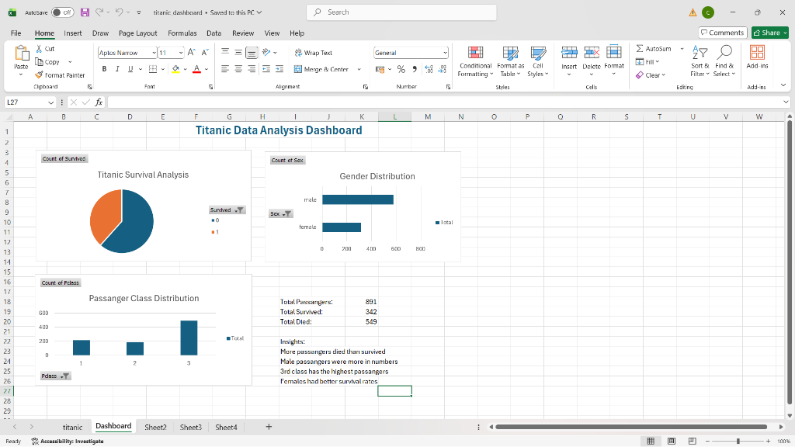

# Titanic Survival & Demographic Exploratory Analysis

## 📊 Dashboard Preview

---

## 📌 Project Overview
The Titanic dataset is the classic industry benchmark for observational demographic analysis and survival probability modeling. 

This project explores the critical socio-demographic factors that influenced passenger survival during the disaster through clean data wrangling, conditional calculations, and an interactive **Excel Executive Dashboard** utilizing Pivot Tables and dynamic Pivot Charts.

---

## 🛠️ Key Analytical Techniques
* **Data Wrangling:** Imputing missing age records, auditing duplicate passenger records, standardizing cabin/fare dimensions.
* **Feature Segmentation:** Segmenting survival distributions across **Gender (Sex)**, **Passenger Class (Pclass: 1st, 2nd, 3rd)**, **Age Groups**, and **Family Composition**.
* **Interactive Tooling:** 
  * Pivot Tables summarizing counts, survival rates, and class distributions.
  * Pivot Charts (Pie & Bar charts) for immediate executive consumption.

---

## 📈 Core Findings & KPI Summary
* **Total Passengers Analyzed:** 891
* **Total Survived:** 342 (38.4%)
* **Total Deceased:** 549 (61.6%)

### Key Insights:
1. **Gender Priority:** Female passengers had a significantly higher survival rate than male passengers, confirming the historical "women and children first" maritime evacuation protocol.
2. **Socio-Economic Disparity:** Class 3 passengers accounted for the highest passenger count but suffered the lowest survival rates due to cabin depth and distance from the boat deck.
3. **Class Demographics:** 1st Class passengers experienced the highest survival likelihood (>62%).

---

## 📂 Repository Contents
* `titanic_dashboard.xlsx`: The master spreadsheet containing raw data, cleaned tables, pivot modeling sheets, and the interactive visual dashboard.
* `Output/Dashboard.png`: High-resolution export of the Excel analytics dashboard.
* `README.md`: Analytical overview and methodology breakdown.

---

## 👤 Author
**Lessly K.J**  
- LinkedIn: [linkedin.com/in/lessly-kj](https://www.linkedin.com/in/lessly-kj)  
- GitHub: [github.com/LESSLY-KJ](https://github.com/LESSLY-KJ)
